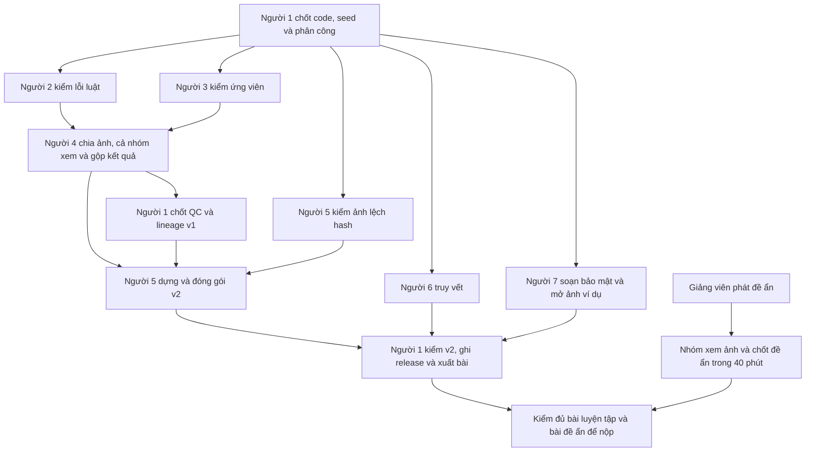

# Day 10 Lab — Kế hoạch thực hiện và bàn giao của T2412

**Đọc theo thứ tự từ mục 1 đến mục 10.** Phân công dùng số vị trí 1–7 để nhóm điền tên sau. File này có thể gửi riêng cho thành viên; đường dẫn tệp trong lệnh tính từ thư mục gốc repo.

- **Repo nhóm** [Cheese1501/K5-L23-Day10-T2412-Dataset-Release-Handover](https://github.com/Cheese1501/K5-L23-Day10-T2412-Dataset-Release-Handover)
- **Seed luyện tập** `2412007`, chọn theo ví dụ `2412 × 1000 + 7` trong GUIDE. **Lô v1** `lab250_ebedbc794d29`.
- **Đội hình** T2412 có 7 người. TV1 cho biết ngày 19/11/2026 rằng đội hình đã được đồng ý. Danh sách tên và MSHV có trong `submission/TEAM.md`. [RULES.md](https://github.com/Cheese1501/K5-L23-Day10-T2412-Dataset-Release-Handover/blob/main/RULES.md)
- **Hạn nộp, kênh nộp và giờ phát đề ẩn** lấy từ giảng viên. Các mốc dưới đây là thời gian làm việc tương đối.

## 1. Hiện trạng và việc bắt đầu ngay

| Đã kiểm tra trên bản local | Còn cần nhóm làm |
|---|---|
| Validator chạy trên seed nhóm, hai seed thử và lô sạch. Seed nhóm có 10 lỗi luật, F1 lỗi luật làm tròn ≈ 1,0. Lô sạch 50 ảnh có 0 lỗi luật và 0 ứng viên. | Người 2 và 3 chạy lại trên bản code cả nhóm sẽ dùng. Nếu đổi cách đối chiếu, đo lại hàng đợi và chia lại ca. |
| Hàng đợi seed nhóm có 6 ứng viên gán nhãn và 1 ảnh lệch hash. v1 đã có HOLD từ 10/250 lỗi luật, tương ứng 4,0%. | Cả 7 người xem ảnh. Người 4 gộp kết quả thật, người 5 chốt ảnh lệch hash, người 1 cập nhật QC. |
| Truy vết có 4 ảnh tầng A, 3 ảnh tầng B, 2 người trong `notify`. Bản nháp v2 có 244 ảnh và 1.682 box. | Người 6 kiểm lại ticket. Người 5 dựng v2 sau review. Số ảnh và số box cuối có thể đổi. |
| Bản nháp v2 đạt 14/17. Ba mục còn mở là H3 review, H14 event release v2 và H17 ví dụ ảnh cho phần bảo mật. | Người 4, 5 và 7 bàn giao bằng chứng để người 1 chạy lại bộ kiểm gốc và xuất bài. |

**Code dùng chung.** Nhánh `docs/t2412-lab-plan` tập hợp kế hoạch, danh sách thành viên, `validator/validate.py` và các công cụ `lab/prepare_review.py`, `lab/trace_ticket.py`, `lab/build_handover.py`. Thành viên lấy nhánh và ghi SHA thực tế bằng `git rev-parse HEAD` trước khi chạy. TV2 và TV3 rà code, TV4 kiểm công cụ xem ảnh và TV5 rà công cụ dựng v2 theo phân công. Dữ liệu `runs/` và `data_source/` được tạo lại trên máy làm việc. Xem `submission/TV1_STATUS.md` để biết đầu ra đã kiểm và những việc đang chờ.

## 2. Ai phụ trách việc gì

| Người | Vào việc ngay | Nhận từ người khác | Bàn giao cho ai |
|---|---|---|---|
| **1. Điều phối và lineage** | Điền phân công, xác nhận đội hình, quyền repo và máy nộp, công bố commit chung. Kiểm lineage hiện có. | `errors.json` từ 4, gói v2 từ 5, `trace.json` từ 6, `security.md` và báo cáo từ 7. | QC và quyết định cho 5, số liệu cho 7, bộ bài nộp và kết quả kiểm cho cả nhóm. |
| **2. Validator lỗi luật** | Kiểm 9 loại lỗi và cách chạy trên seed nhóm, seed độc lập, lô sạch. Ưu tiên lỗi file, SHA-256, biên box, split và guideline theo job. | Phần đối chiếu đã tích hợp từ 3 để chạy lệnh cuối trên cùng code. | `rules.json` cho 4, số liệu kiểm luật cho 7. |
| **3. Đối chiếu detection và panoptic** | Kiểm ghép theo tên lớp, IoU và tỉ lệ pixel mask nằm trong box, đo ứng viên trên lô sạch. | Bản chạy của 2 để thống nhất dữ liệu đầu vào và phiên bản validator. | `candidates.json` cho 4, ngưỡng và số ứng viên cho 7. |
| **4. Công cụ ảnh và review** | Kiểm mở ảnh, box và mask, chuẩn bị CSV và bảng chia ảnh. | `rules.json`, `candidates.json`, ghi chú trực tiếp của cả 7 người. | `review_log.csv` và `errors.json` đã gộp cho 1 và 5. |
| **5. Hash và v2** | Mở ảnh lệch hash, đọc bản nháp và kiểm các quy tắc giữ ảnh hoặc đưa vào rework. | `errors.json` từ 4, QC v1 cuối từ 1. | Gói v2, SHA-256 và vị trí file cho 1, số ảnh và box cuối cho 7. |
| **6. Truy vết ticket** | Đọc ticket, changelog, metadata, jobs và nhãn detection. Chạy hoặc kiểm lại kết quả truy vết song song với review. | Chốt cùng phiên bản `delivery/` với người 1. | `trace.json` cho 1, tiêu chí và số lượng từng tầng cho 7. |
| **7. Bảo mật và báo cáo** | Soạn ba mục bảo mật, mở một ảnh có khuôn mặt rõ, chuẩn bị báo cáo, xem chéo một ca gán nhãn. | Số liệu cuối từ 1, 2, 3, 4, 5 và 6. | `security.md`, `submission/REPORT.md`, `submission/prompts.md` cho 1. |

**Quy ước cộng tác.** Người 2 và 3 có thể phân tích song song. Nếu cùng sửa `validator/validate.py`, chia phần luật và phần đối chiếu, rồi tích hợp tuần tự trước khi chạy lại. Người 4 gộp CSV, người 1 xuất bài, người 5 ghi bộ v2. Trước khi chuyển giao một file, gửi cả đường dẫn và commit hoặc seed dùng để tạo file. Dùng máy tích hợp để gom các bản cuối. Thành viên làm trên máy riêng có thể chuyển file đầu ra đúng seed qua kênh nội bộ nhóm hoặc chạy lại trên máy tích hợp từ code chung. Với v2, người 5 dựng trực tiếp trên máy tích hợp hoặc chuyển cả thư mục v2 kèm `.sha256`. Các ID ảnh trong kế hoạch phục vụ phân công review, giữ phần validator độc lập với các ID này.

## 3. Thứ tự thực hiện và các việc chạy song song

| Đợt | Bắt đầu trước | Làm song song | Điều kiện chuyển bước |
|---|---|---|---|
| **A · 0:00–0:15** | **1** xác nhận vai trò, commit chung, seed và máy tích hợp. | **2–7** kiểm Python, quyền repo và lô luyện tập. **1** đối chiếu tên fork với quy ước lớp và hỏi về đội hình 7 người nếu chưa có xác nhận. | Máy tích hợp mở được `delivery/`. Nhóm biết ref nào để lấy code và ai phụ trách từng đầu ra. |
| **B · 0:15–0:55** | **2 và 3** chạy lại luật và đối chiếu. **4** thử trang review rồi chờ danh sách đã chốt để chia ca. | **5** kiểm ảnh hash và chuẩn bị v2. **6** truy vết từ v1. **7** soạn bảo mật, mở ảnh ví dụ và chuẩn bị khung báo cáo. **1** kiểm lineage. | **2 → 4** giao `rules.json`. **3 → 4** giao `candidates.json`. **4** công bố danh sách theo phiên bản validator chung. |
| **C · 0:55–1:50** | **4** chia ảnh. **Cả 7** xem ảnh đã nhận và gửi kết luận. | **5** kết thúc hash. **6** kiểm kết quả trace. **7** xem chéo trước khi đọc ghi chú của 4. | **4** gộp review và giao `errors.json` cho **1 và 5**. **5** có `hash_review.csv` hợp lệ. |
| **D · 1:50–2:05** | **1** đếm lỗi v1 sau review, xác nhận HOLD và chạy impact. | **5** đối chiếu danh sách cần rework. **7** nhận số liệu QC và tác động. | **1 → 5** xác nhận QC cuối. **5** có đủ lỗi cuối và kết quả hash để dựng v2. |
| **E · 2:05–2:45** | **5** dựng, kiểm nội dung, đóng gói v2 rồi giao **1**. | **6** và **7** hoàn thiện trace và bảo mật. **4** đối chiếu log với lỗi cuối. **2 và 3** giải thích kết quả validator khi có vướng mắc. | **5 → 1** giao thư mục v2 và checksum. **6 → 1** giao trace. **7 → 1** giao bảo mật, báo cáo và nhật ký AI. |
| **F · 2:45–3:15** | **1** chạy bộ kiểm trên v2 chính thức. Sau khi nhóm chốt v2 và các mục khác đạt, ghi event release rồi kiểm lại. | Chủ từng đầu ra xử lý mục FAIL của mình. **7** cập nhật số liệu sau kiểm cuối. Cả nhóm hoàn tất các commit có nội dung. | Bộ kiểm gốc 0 FAIL. `export_submission.py` đã xuất đúng seed và lineage. Kiểm riêng các file vào Git. |
| **G · 40 phút khi nhận đề ẩn** | **2** chạy validator trên dữ liệu được phát. **4** chia ảnh. **6** đọc ticket song song. | **Cả nhóm** xem ảnh. **1** chuẩn bị nơi nộp, **7** xem chéo ca khó. | Có đủ bốn file đề ẩn và đã nộp theo giờ, kênh giảng viên công bố. |

**Luồng phụ thuộc chính**



Giờ phát đề ẩn do lớp quyết định. Nếu đến giờ làm đề ẩn khi lô luyện tập còn chỉnh, ưu tiên bài 40 phút và giữ riêng hai bộ dữ liệu, hai bộ kết quả.

## 4. Chuẩn bị trên máy thành viên

**Người 1** công bố fork và commit dùng chung. Nếu clone mới, checkout nhánh đã thống nhất trước khi chạy các lệnh dưới đây. Mỗi người kiểm có Python từ 3.10. Máy tích hợp tạo lô chính trước khi tạo các seed phụ để `R-021` được gắn đúng lô.

```sh
git clone https://github.com/Cheese1501/K5-L23-Day10-T2412-Dataset-Release-Handover.git
cd K5-L23-Day10-T2412-Dataset-Release-Handover
git rev-parse --short HEAD
python3 --version
python3 scripts/download_public.py
python3 scripts/run_lab.py --seeds 2412007
```

Chỉ chạy `run_lab.py` nếu máy chưa có lô `runs/r2412007/delivery/`. Có thể tổ chức xem ảnh trên máy tích hợp để tránh tải lại dữ liệu trên từng máy. Trên Windows, dùng `py` thay `python3`, chạy từng dòng bằng PowerShell. Dùng `Invoke-Item runs/r2412007/review.html` để mở hàng đợi thay cho `open` trên macOS. Nếu thiếu code trong `validator/` hoặc `lab/`, báo người 1 để đối chiếu ref trước.

**Người 2 và 3** chạy trên bản code đã tích hợp. Seed phụ và lô sạch dùng `inject_release.py`, chỉ tạo khi chưa có lô tương ứng.

```sh
python3 scripts/inject_release.py --seed 22 --out runs/r22
python3 scripts/inject_release.py --seed 5 --no-faults --out runs/clean
python3 validator/validate.py runs/r22/delivery --out runs/r22/errors.json
python3 scripts/score_findings.py --run runs/r22
python3 validator/validate.py runs/clean/delivery --out runs/clean/rules.json --candidates runs/clean/candidates.json
python3 validator/validate.py runs/r2412007/delivery --out runs/r2412007/rules.json --candidates runs/r2412007/candidates.json
```

Người 2 xác nhận lô sạch có 0 lỗi luật. Người 3 ghi số ứng viên thực tế và giải thích ngưỡng. Nếu hàng đợi đổi, chuyển danh sách mới cho 4 và báo cả nhóm trước khi xem ảnh. Validator chỉ dùng thư viện chuẩn và dữ liệu trong `delivery/` được truyền vào. Dùng script tự đo đúng chế độ học viên và giữ đáp án riêng của bộ chấm ngoài quá trình làm bài. [GUIDE.md](https://github.com/Cheese1501/K5-L23-Day10-T2412-Dataset-Release-Handover/blob/main/GUIDE.md) · [Định dạng delivery](https://github.com/Cheese1501/K5-L23-Day10-T2412-Dataset-Release-Handover/blob/main/docs/DELIVERY.md)

## 5. Chia, xem và gộp ảnh

**Người 4** tạo trang xem sau khi nhận kết quả của 2 và 3. Lệnh chuẩn bị giữ các CSV đã tồn tại, vì vậy khi hàng đợi thay đổi, lưu bản CSV đang dùng rồi đối chiếu danh sách cũ với mới để giữ kết quả thật và bổ sung các ca mới.

```sh
python3 lab/prepare_review.py runs/r2412007/delivery --workdir runs/r2412007
open runs/r2412007/review.html
```

| Người | Mã ảnh theo hàng đợi hiện tại | Việc cần làm trên ảnh |
|---|---|---|
| **1** | `000000009891` | Nhìn vật trong vùng bất đồng lớp, xác định nguồn ghi sai nếu có. |
| **2** | `000000018491` | Mở ảnh thật và đối chiếu lớp của hai bộ nhãn. |
| **3** | `000000006012` | Xem có hai vật riêng và mask có gộp chúng thành một segment hay không. |
| **4** | `000000023023` | Xem độc lập ca bất đồng lớp, sau đó so nhận xét với 7. |
| **5** | `000000023781` và `000000004765` | Ảnh đầu kiểm box có lệch khỏi vật. Ảnh sau mở để kiểm nội dung vì SHA-256 lệch. |
| **6** | `000000025386` | Nhìn chi tiết phân biệt lớp và xác định nguồn ghi sai nếu có. |
| **7** | `000000023023` và một ảnh cho mục bảo mật | Xem chéo trước khi đọc nhận xét của 4. Tự chọn, mở và ghi mã ảnh có khuôn mặt nhìn rõ. |

1. Mở ảnh gốc và phóng to vùng cần xem. Khi có ích, mở box và mask để đối chiếu. Các mô tả trong hàng đợi là tín hiệu cần kiểm.
2. Gửi người 4 một dòng cho mỗi ca, theo thứ tự `image,type,verdict,note`. Giữ mã ảnh dạng văn bản để còn các số 0 đầu. Ghi tên người xem và ít nhất 20 ký tự mô tả quan sát cụ thể.
3. Với ca bất đồng lớp, `class_swap` là detection ghi nhầm và `category_swap` là panoptic ghi nhầm. Dùng `confirmed` khi quan sát ủng hộ loại lỗi. Dùng `rejected` khi ảnh cho thấy nhãn vẫn hợp lý hoặc lệch tự nhiên. Nếu chưa nhìn rõ, đưa ca cho người thứ hai xem trước khi chốt.
4. Người 4 ghi một kết luận cho mỗi ca sau khi đối chiếu các ý kiến. Với ca xem chéo, ghi tên những người thực sự đã xem trong ghi chú. Giữ kết luận của người xem và tránh lặp ghi chú giữa các ảnh.
5. Người 5 ghi `hash_review.csv` theo `image,status,reviewer,note`. Dùng `intact` nếu nội dung ảnh kiểm được và còn nguyên, `damaged` nếu hỏng. Gửi người 4 biết ca hash đã kiểm và giữ kết quả cho v2.
6. Sau khi đủ ca, người 4 chạy lệnh gộp. Kiểm từng lỗi gán nhãn trong file cuối có dòng `confirmed` tương ứng trong log.

```sh
python3 scripts/merge_review.py --rules runs/r2412007/rules.json --review runs/r2412007/review_log.csv --out runs/r2412007/errors.json
python3 scripts/score_findings.py --run runs/r2412007
```

**Điểm bàn giao của người 4.** Gửi `errors.json` cho 1 và 5. Gửi số ca confirmed, rejected và số liệu F1 làm tròn thực tế cho 7. Nếu bỏ sót ca, giữ trạng thái chờ review. Mỗi dòng `confirmed` hoặc `rejected` phải do thành viên xem ảnh và ghi nhận.

## 6. Chốt QC, dựng v2 và hoàn thiện hai việc song song

### 6.1. Người 1 chốt QC v1 trước khi người 5 dựng v2

- Xác nhận đúng `release_id` bằng `runs/r2412007/delivery/release.json`. Đếm ảnh hoặc cảnh lỗi từ `errors.json`, mỗi target tính một lần, rồi chia cho 250. Áp quy ước `scene_leak` tính một ca theo GUIDE.
- Nếu vượt 2% thì HOLD. Trên máy đã chuẩn bị, event HOLD của `lab250_ebedbc794d29` đã có. Trên máy tích hợp mới, ghi event nếu chưa có. Kiểm `runs/lineage.jsonl` trước khi ghi để tránh dòng trùng.
- Chạy impact và giao người 5 tử số, mẫu số, quyết định. Giao người 7 thông tin `R-021` để giải thích vì sao cần xem lại hoặc train lại.

```sh
# Chỉ chạy dòng record nếu chưa có HOLD cho release ID này và QC vượt 2%.
python3 scripts/lineage.py record --event decision --release-id lab250_ebedbc794d29 --decision HOLD
python3 scripts/lineage.py impact --release-id lab250_ebedbc794d29
```

### 6.2. Người 5 dựng bản v2 khi đã có kết quả gộp và kiểm hash

| Phát hiện | Xử lý trong v2 detection |
|---|---|
| `missing_image`, `invalid_class`, `bbox_out_of_bounds`, `duplicate_box`, `class_swap`, `bbox_drift`, `missing_box` | Tách ảnh khỏi v2 và ghi `rework_queue.csv`, lấy đúng người gán và người kiểm từ `jobs.csv`. |
| `invalid_category_id`, `thing_overlap`, `category_swap`, `instance_merge` | Giữ ảnh nếu nhãn detection đủ điều kiện. Ghi mã ảnh và lỗi để báo đội panoptic. |
| `wrong_hash` | Ảnh đã kiểm là nguyên thì ghi hash thật trong manifest v2. Ảnh hỏng chuyển rework. |
| `guideline_mismatch` và `scene_leak` | Lấy guideline theo job, thống nhất split của từng cảnh trong `truyvet.csv`. |

Thư mục bàn giao có `images/`, `labels/`, `manifest.csv`, `label_summary.csv`, `truyvet.csv`, `rework_queue.csv` và `README.txt`. Người 5 đối chiếu số ảnh v2, số nhãn, SHA-256 của file, tỷ lệ QC v1 và các trường hợp rework trước khi đóng gói. Bảo toàn thư mục v1 và nhãn đã giao. Nếu sửa nội dung v2 sau khi đóng gói, cập nhật manifest và thống kê liên quan rồi đóng gói lại.

```sh
python3 lab/build_handover.py --run runs/r2412007
python3 scripts/pack_release.py runs/r2412007/handover/lab250_ebedbc794d29_v2
```

Nếu thư mục v2 chính thức đã tồn tại, kiểm nội dung hiện có và lưu phiên bản đó ở vị trí khác trước khi dựng lại. Thư mục `draft/` là bản nháp, còn bộ kiểm chính thức đọc từ `handover/`.

### 6.3. Người 6 truy vết, có thể bắt đầu ngay sau đợt A

1. Đọc `incoming/ticket.md` và `guideline/changelog.md` trong delivery để xác định cảnh được nêu, lớp đổi quy tắc và guideline cũ.
2. Đối chiếu `jobs.csv` và `metadata.json` để tìm ảnh thuộc job có guideline cũ. Đọc nhãn detection của các ảnh này để chọn ảnh có ít nhất một box của lớp bị đổi quy tắc.
3. `tier_a` lấy các ảnh đủ điều kiện trong cảnh nêu trong ticket. `tier_b` lấy các ảnh đủ điều kiện ở cảnh khác. `notify` gồm mã người gán và người kiểm từ các job của cả hai tầng. Kiểm hai tầng không trùng và mọi mã người đều có trong `jobs.csv`.
4. Giao `trace.json` cho người 1. Gửi số lượng theo từng khóa và cách tra guideline cho người 7.

```sh
python3 lab/trace_ticket.py runs/r2412007/delivery --out runs/r2412007/trace.json
```

### 6.4. Người 7 làm bảo mật song song, khóa báo cáo sau khi có số liệu cuối

- Trong `runs/r2412007/security.md`, viết ba mục về USB, năm tình huống được hoặc không được, và ca khuôn mặt. Với ca khuôn mặt, ghi **HOLD**, báo người phụ trách và nêu mã ảnh mà thành viên đã mở thấy rõ mặt người.
- Dùng số liệu thật ở `report.md` của lô, `README.txt` của v2, `trace.json` và kết quả kiểm để cập nhật `submission/REPORT.md`. Ghi vì sao báo hết ứng viên có thể giảm precision và F1, vì sao guideline lấy theo job, và vì sao sửa lô mới vẫn cần xem lại run đã train.
- Ghi người dùng AI, prompt, hạn chế hoặc sai sót phát hiện và cách người trong nhóm kiểm lại vào `submission/prompts.md`. Giao tài liệu cho người 1 khi mọi số liên quan đã chốt.

## 7. Kiểm v2, ghi release và xuất bài luyện tập

**Người 1** tập hợp `errors.json`, `review_log.csv`, `trace.json`, `security.md`, gói v2 kèm SHA-256 và lineage trên máy tích hợp. Chạy bộ kiểm gốc.

```sh
python3 scripts/check_handover.py --run runs/r2412007
```

| Mục FAIL | Người xử lý | Kiểm lại |
|---|---|---|
| H1–H2 | 2, 4 và 1 | V1 còn nguyên, chạy đúng seed, lỗi luật có mặt trong file đã gộp. |
| H3 | 4 và người xem ca bị thiếu | Ghi chú đủ dài, có chi tiết thật và đủ dòng `confirmed` cho lỗi gán nhãn. |
| H4–H13 và H15 | 5 với 1 | Đủ file, đúng người xử lý, số liệu và hash chính xác, ZIP và checksum khớp. |
| H14 | 1 | Event HOLD v1, event release v2 và đúng `parent`. |
| H16 | 6 | `tier_a` và `notify` có dữ liệu, tên ảnh và mã người hợp lệ. |
| H17 | 7 | Đủ ba mục, có HOLD và mã ảnh có khuôn mặt do người trong nhóm kiểm. |

Nếu chỉ còn H14 vì thiếu event release, các phần khác đạt và nhóm đã chốt v2, ghi release **một lần**, kiểm lại và chỉ xuất khi bộ kiểm trả 0 FAIL.

```sh
python3 scripts/lineage.py record --event release --release-id lab250_ebedbc794d29_v2 --parent lab250_ebedbc794d29
python3 scripts/check_handover.py --run runs/r2412007
python3 scripts/export_submission.py --run runs/r2412007
git status --short
```

**Kiểm sau khi xuất.** `submission/r2412007/` có `errors.json`, `candidates.json`, `review_log.csv`, `trace.json`, `security.md`, thư mục v2 và file `.sha256`. `submission/lineage.jsonl` có v1 HOLD và v2 có parent. README repo ghi Nhóm T2412, `TEAM.md` đủ thông tin và báo cáo có số liệu cuối. Soát các file đã stage. Giữ `runs/`, `data_source/`, `delivery/` của đề ẩn, `*.zip` và thông tin bí mật ngoài Git. Mỗi thành viên có ít nhất hai commit có nội dung do họ thực hiện và dưới danh tính của họ. [SUBMISSION.md](https://github.com/Cheese1501/K5-L23-Day10-T2412-Dataset-Release-Handover/blob/main/SUBMISSION.md)

## 8. Tổ chức 40 phút đề ẩn

Chỉ bắt đầu khi giảng viên phát `de_an.zip` hoặc dữ liệu tương đương. Giải nén theo GUIDE để có `delivery/` ở gốc repo. Giữ output của đề ẩn trong đường dẫn riêng, và tuân thủ quy định về các công cụ được dùng tại lớp.

| Phút | Ai làm trước | Ai làm song song | Phải đạt khi hết mốc |
|---|---|---|---|
| **0–5** | **2** nhận lô và chạy validator, **3** kiểm cấu trúc kết quả. **4** chia danh sách theo ảnh. | **6** đọc ticket và changelog, **1** kiểm nơi nộp và giờ kết thúc. | Có luật và danh sách ứng viên của đề mới. Mỗi ảnh có người phụ trách. |
| **5–27** | **Cả 7** xem ca được giao. **4** nhận dòng review theo từng đợt. | **6** hoàn thành trace, **7** xem chéo ca khó. **1** xác nhận đủ người đã xem ảnh. | Có bằng chứng review thật cho các kết luận, trace được chuyển cho 1. |
| **27–34** | **4** gộp CSV và chạy script merge. | **2** kiểm lỗi luật, **3** đối chiếu loại lỗi gán nhãn, **5 và 7** rà ảnh chưa rõ nếu còn thời gian. | Có `errors.json` cuối dựa trên lỗi luật và review đã xác nhận. |
| **34–40** | **1** kiểm đủ file, điều phối commit, push và nộp qua tài khoản có quyền. | **4** đối chiếu log, **6** kiểm trace, người khác kiểm commit của mình. | Nộp theo mốc của lớp. Giữ mã commit và thời gian nộp để nhóm đối chiếu. |

Lệnh chạy đầu tiên tạo `rules.json` trong `runs/de_an_work/` làm file trung gian. Quy trình gộp vẫn dùng script gốc của lab. Trên Windows, tạo trước thư mục `submission/de_an` bằng trình quản lý tệp hoặc PowerShell nếu cần.

```sh
python3 validator/validate.py delivery --out runs/de_an_work/rules.json --candidates submission/de_an/candidates.json
# Sau khi người 4 tổng hợp review_log.csv do thành viên xem ảnh.
python3 scripts/merge_review.py --rules runs/de_an_work/rules.json --review submission/de_an/review_log.csv --out submission/de_an/errors.json
```

Bộ nộp đề ẩn gồm `submission/de_an/errors.json`, `candidates.json`, `review_log.csv` và `trace.json`. Người 6 áp tiêu chí ở mục 6.3 cho ticket, job và nhãn của lô mới. Dùng validator và công cụ xem ảnh của nhóm theo quy định lớp. Kế hoạch để AI rà soát được chia sẻ trước buổi đề ẩn. [GUIDE.md – đề ẩn](https://github.com/Cheese1501/K5-L23-Day10-T2412-Dataset-Release-Handover/blob/main/GUIDE.md#L156) · [RULES.md](https://github.com/Cheese1501/K5-L23-Day10-T2412-Dataset-Release-Handover/blob/main/RULES.md)

## 9. Mẫu bàn giao giữa thành viên

Gửi mẫu này cho người nhận nêu ở mục 2. Đường dẫn phải trỏ tới file đã tạo hoặc được ghi rõ là dự kiến.

```text
Vị trí và người phụ trách:
Việc đã làm:
Seed và commit đã dùng:
File bàn giao:
Kết quả đã xác minh:
Việc còn thiếu hoặc chưa xác minh:
Người nhận và điều họ có thể bắt đầu:
```

Nếu thiếu đầu vào, báo người đang giữ file và chỉ rõ đường dẫn hoặc kết quả còn thiếu. Tiếp tục những việc độc lập trong cùng đợt. Nếu cần sửa sau khi bàn giao, báo bên nhận, phát lại file đã sửa và chạy lại bước phụ thuộc. Ví dụ, khi `errors.json` đổi, người 1 tính lại QC, người 5 dựng hoặc cập nhật v2, rồi người 1 kiểm và xuất lại.

**Chuẩn bị vấn đáp.** Mỗi người chuẩn bị giải thích một đoạn validator, một ảnh mình đã trực tiếp xem và cách nhóm lấy một con số trong README v2. [RUBRIC.md](https://github.com/Cheese1501/K5-L23-Day10-T2412-Dataset-Release-Handover/blob/main/RUBRIC.md)

## 10. Prompt gửi kèm file cho AI agent của từng thành viên

Điền vị trí vào chỗ trống và gửi prompt này cùng file Markdown. Thành viên thu lại câu trả lời và chuyển cho người 1 để xử lý các mâu thuẫn hoặc cập nhật phân công.

```text
Tôi phụ trách vị trí [1–7] trong nhóm T2412. Hãy đọc file kế hoạch
và phân tích phần việc của tôi. Repo và tài liệu chính thức có link trong file.
Nếu tôi cung cấp checkout, hãy đối chiếu lệnh với đúng commit tôi đang dùng.

Trả lời theo 6 mục.
1. Những việc tôi có thể bắt đầu ngay, theo thứ tự.
2. Việc nào phải chờ và cần ai bàn giao file hoặc kết quả gì.
3. Việc nào tôi có thể làm song song, và có ai cùng sửa một file với tôi không.
4. Các lệnh cần chạy, output và cách kiểm từng output trước khi bàn giao.
5. Mâu thuẫn hoặc giả định cần nhóm làm rõ. Dẫn tên file và dòng nếu đã đọc.
6. Mẫu tin bàn giao đã điền phần xác minh được, để trống các kết quả chưa có.

Lượt này chỉ phân tích kế hoạch. Không sửa repo hoặc thực hiện thao tác Git
từ xa. Phân biệt số đã thấy trong bằng chứng với số dự kiến. Không tạo
kết luận review ảnh, số F1 hoặc kết quả kiểm khi chưa có bằng chứng.
Tuân thủ RULES.md và phạm vi công cụ của đề ẩn.
```
